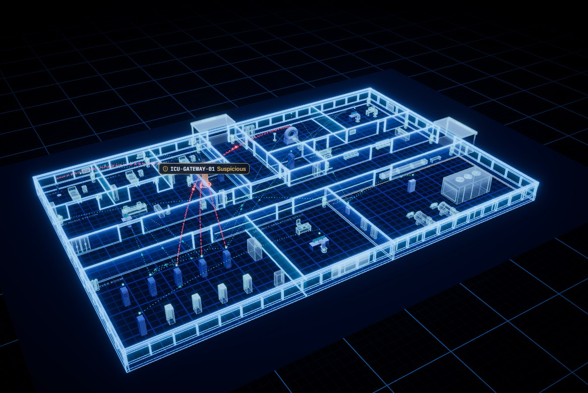
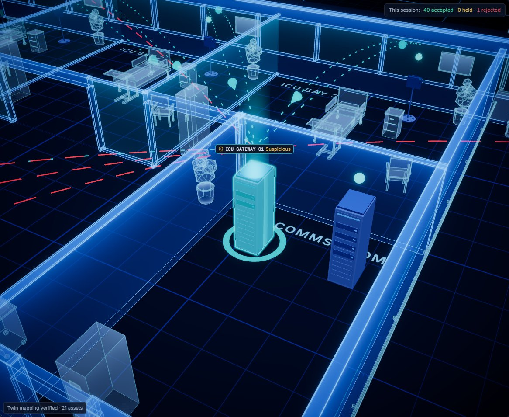
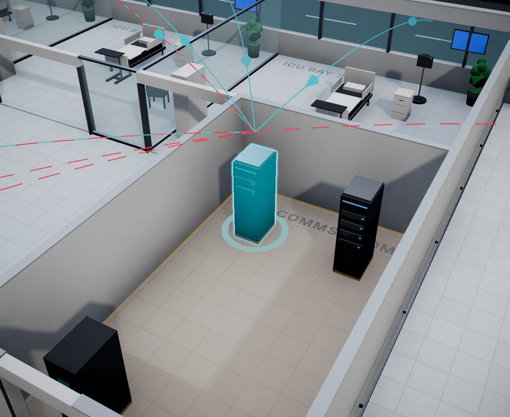
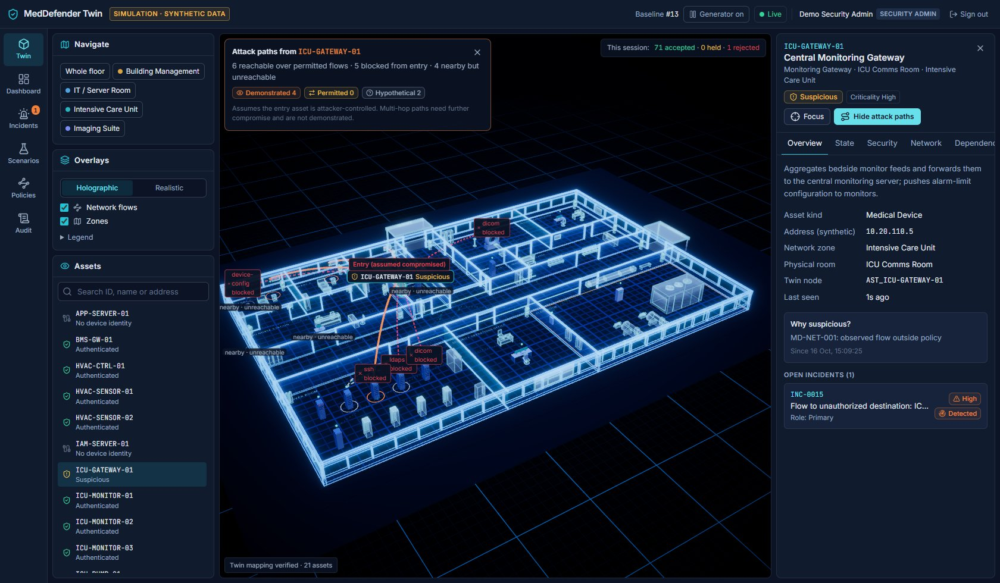

# MedDefender Twin

[](https://github.com/FuadAhamed91/meddefender-twin/actions/workflows/ci.yml)

**A healthcare IoT cybersecurity simulation with a live 3D digital twin of a (synthetic) hospital.**

> ⚠️ **Simulation only.** Every hospital asset, network flow, telemetry value, clinical
> workflow and attack in this project is synthetic. It does not connect to or control real
> clinical infrastructure or medical devices, and it makes no claim of clinical safety,
> regulatory compliance, certification or production readiness.

**Live deployment:** https://meddefender-twin.vercel.app (Vercel + Supabase, synthetic data;
sign-in accounts are private to the deployment's owner). See
[Deploy to Vercel](#deploy-to-vercel-serverless).



MedDefender Twin simulates one hospital floor (ICU, imaging suite, server room and building
management) and runs a real security pipeline over signed device messages: identity,
HMAC-SHA-256 integrity, replay protection, explainable policy enforcement and deterministic
detection rules. The 3D twin is a **projection of that backend state**. It shows where an
affected asset is, what it can still reach under current policy, what depends on it, and
what a containment decision would disrupt. It never invents security state of its own.

| Selected device: outline, light pillar, related flows only | Same device in the realistic view |
|---|---|
|  |  |



## Contents

- [What it does](#what-it-does)
- [Quick start (Docker Compose)](#quick-start-docker-compose)
- [Deploy to Vercel (serverless)](#deploy-to-vercel-serverless)
- [Local development](#local-development)
- [Configuration](#configuration)
- [Tests](#tests)
- [Architecture](#architecture)
- [Security model in brief](#security-model-in-brief)
- [API](#api)
- [Project structure](#project-structure)
- [Implemented vs future work](#implemented-vs-future-work)
- [Known limitations](#known-limitations)

## What it does

**Device security pipeline.** Every simulated device message, whether from the background
generator, an HTTP client or an attack scenario, goes through the same `IngestionPipeline`:
identity, schema, HMAC over the raw body (constant-time compare), sequence, freshness,
nonce, value ranges and consistency, policy, and a model check. Replay state is row-locked
and persisted, so it survives restarts. A message that is authentic but disagrees with the
model is **held**, never trusted.

**Three state models per asset.** *Reported* (what the device said), *trusted* (what passed
every check) and *predicted* (what a deterministic physical model expects) are stored and
shown separately. Rejected or held telemetry cannot overwrite trusted state.

**Explainable policy.** Network-flow and device-command policies are evaluated by priority
with default deny; every decision records the matched rule, shadowed rules and a reason.
Policies can run in *monitor-only* mode. Device trust states (`REGISTERED`,
`AUTHENTICATED`, `SUSPICIOUS`, `QUARANTINED`, `REVOKED`, `OFFLINE`, plus `UNREGISTERED` for
endpoints the sensor sees but the registry does not know) gate what an identity may do.

**Detection without overclaiming.** 21 deterministic rules (not machine learning) raise
alerts classified as confirmed policy violation, protocol violation, validation failure,
authentication failure or *suspected anomaly*. Each alert carries a confidence note; an
anomaly is never presented as proof of compromise.

**Graphs.** The network graph (modeled communication paths, evaluated against policy at
query time) and the operational-dependency graph (what relies on what) are separate.
Attack-path analysis only traverses flows the policy engine permits and labels every hop
*demonstrated*, *permitted* or *hypothetical*; nearby-but-unreachable assets are listed too.

**Incidents, containment and recovery.** Alerts correlate into incidents with an enforced
lifecycle (Detected → Investigating → Containment proposed → Contained → Recovery →
Resolved). Containment plans (isolate, restrict to required flows, block zone egress,
revoke credentials) are compared on blocked flows, residual attack paths and disrupted
services *before* anything changes. Applying a plan that impairs a service requires a
security admin. Recovery rotates keys, lifts containment and re-anchors trusted state, and
every incident can be replayed step by step.

**Audit.** An append-only audit trail (ORM guard plus a PostgreSQL trigger) with a SHA-256
hash chain that can be verified from the UI.

**Six attack scenarios (A–F),** all executed through the real pipeline, each evaluated
against persisted state rather than scripted results:

| | Scenario | Exercises |
|---|---|---|
| A | Replayed medical telemetry | HMAC (passes), sequence, nonce, freshness, trusted-state protection |
| B | Unauthorized device command | Command policy (default deny), trust gate, least privilege |
| C | Rogue device registration | Identity registry, default-deny flows, enrollment approval |
| D | Compromised gateway and lateral movement | Flow policy, new-path detection, policy-aware attack paths |
| E | Telemetry manipulation | Schema and limit validation vs model discrepancy; reported/trusted/predicted |
| F | Containment planning | Plan comparison, dependency impact, authorized application, recovery |

**The 3D twin** (React Three Fiber) loads a Blender-generated GLB whose nodes carry the
backend asset IDs and verifies the mapping on every load. It offers a holographic security
view and a realistic architectural view, live flow animation from the event stream, light
pillars for abnormal backend states, and attack-path and containment previews. Only devices
that need attention (selected, alerting, or in an abnormal trust or containment state) carry
a label; the rest are small markers, so the floor stays readable. Status is never conveyed
by color alone: every state has an icon and a text label. Motion is reserved for live events.

A walkthrough of every scenario in the UI is in **[docs/DEMO.md](docs/DEMO.md)**.

## Quick start (Docker Compose)

Requirements: Docker with Compose v2.24 or newer.

```bash
git clone https://github.com/FuadAhamed91/meddefender-twin.git
cd meddefender-twin
cp .env.example .env
```

Set `DEVICE_KEY_MASTER_SECRET` in `.env` to a random value of at least 32 characters (the
backend refuses to start with the placeholder). Generate one with any of:

```bash
openssl rand -hex 32
```

```bash
python -c "import secrets; print(secrets.token_urlsafe(48))"
```

Then build and start the stack:

```bash
docker compose up --build
```

Open **http://localhost:8080** and sign in with one of the demo accounts created by the seed
(passwords come from your `.env`; the defaults in `.env.example` are shown):

| User | Role | Can |
|---|---|---|
| `viewer` | Viewer | Look at everything; change nothing |
| `operator` | Operator | Run scenarios, manage incidents, apply low-impact containment, recover, verify the audit chain |
| `secadmin` | Security admin | Everything, including high-impact containment, identities, policies and baseline reset |

The compose stack runs PostgreSQL 16, the API (migrations and the idempotent seed run on
start) and nginx serving the console and proxying `/api` and `/ws` on a single origin. The
port is bound to `127.0.0.1` only, because the demo ships with known passwords. To use
another port set `MEDDEFENDER_HTTP_PORT` and add the new origin to `ALLOWED_ORIGINS`.

```bash
docker compose down        # stop (data is kept in the pgdata volume)
docker compose down -v     # stop and delete the database volume
```

## Deploy to Vercel (serverless)

The same code runs on Vercel: the console is served as static files and the API as a Python
function ([api/index.py](api/index.py), configured in [vercel.json](vercel.json)), backed by
any PostgreSQL that is reachable over IPv4 through a connection pooler (the live
deployment uses Supabase). Serverless hosts allow no background processes or WebSocket
servers, so with `SERVERLESS=true`:

- the console polls `GET /api/v1/events?since=<id>` every 3 seconds (the same persisted
  events the WebSocket streams) and stops while the tab is hidden;
- the simulation advances when those polls arrive (one tick per interval, coordinated
  through the database, never during a scenario run), so it is idle while nobody watches;
- database connections are not pooled in the function; use the provider's transaction
  pooler, which also rules out server-side prepared statements (disabled automatically).

Steps:

1. **Database.** Create a PostgreSQL 16+ database. Put the tables in a dedicated schema
   owned by a dedicated role, not in a schema your provider exposes through an
   auto-generated API (for Supabase, not `public`). For example:
   `create role meddefender_app login password '...'`, then
   `create schema meddefender authorization meddefender_app` and
   `alter role meddefender_app set search_path = meddefender`.
2. **Schema and seed**, from `backend/`, with `DATABASE_URL` pointing at the database (a
   session-mode connection), plus a fresh `DEVICE_KEY_MASTER_SECRET` and strong
   `DEMO_PASSWORD_*` values: `uv run alembic upgrade head` and `uv run python -m app.seed`.
3. **Vercel project.** `vercel link`, then add these production environment variables:
   `DATABASE_URL` (the *transaction* pooler URL, `postgresql+psycopg://...`),
   `DEVICE_KEY_MASTER_SECRET` (the same value the seed used), `ENVIRONMENT=production`,
   `COOKIE_SECURE=true`, `SERVERLESS=true`.
4. **Deploy:** `vercel deploy --prod`. Check `https://<your-domain>/api/v1/health`.

`requirements.txt` at the repository root is exported from `backend/uv.lock` for the
function (`uv export --frozen --no-dev --no-hashes --no-emit-project`).

## Local development

Requirements: Python 3.12 with [uv](https://docs.astral.sh/uv/), Node.js 24, and either
PostgreSQL 16 or the embedded one described below. The commands assume a POSIX shell; they
work the same in PowerShell.

```bash
cp .env.example .env       # then set DEVICE_KEY_MASTER_SECRET as above
```

**Database.** Without Docker or a local PostgreSQL install, the backend can run an embedded
PostgreSQL 16 from the `pgserver` wheel on port 55432 (the default `DATABASE_URL`):

```bash
cd backend
uv sync --extra localpg
uv run --extra localpg python scripts/local_postgres.py start
```

It creates the `meddefender` and `meddefender_test` databases; `status` and `stop` work as
you would expect. Keep `--extra localpg` on later `uv sync` runs, since a plain sync removes
the extra. With your own PostgreSQL, point `DATABASE_URL` at it instead.

**Backend** (from `backend/`):

```bash
uv run alembic upgrade head
uv run python -m app.seed
uv run uvicorn app.main:create_app --factory --host 127.0.0.1 --port 8000
```

API docs are served at http://127.0.0.1:8000/api/docs.

**Frontend** (from `frontend/`, proxies `/api` and `/ws` to `MEDDEFENDER_API`, default
`http://127.0.0.1:8000`):

```bash
npm ci
npm run dev
```

Open http://127.0.0.1:5173.

**3D model.** `frontend/public/models/hospital.glb` is committed. To rebuild it from
`shared/hospital_layout.json` with Blender 5.x (headless):

```bash
blender --background --factory-startup --python blender/build_hospital.py -- \
  --layout shared/hospital_layout.json --out frontend/public/models/hospital.glb
```

See [blender/README.md](blender/README.md) for the naming and mapping conventions.

## Configuration

All settings are environment variables (or `.env` at the repository root).

| Variable | Default | Purpose |
|---|---|---|
| `DEVICE_KEY_MASTER_SECRET` | (required) | Root secret from which per-device HMAC keys are derived (KMS stand-in, at least 32 characters) |
| `DATABASE_URL` | local embedded PostgreSQL | SQLAlchemy URL (`postgresql+psycopg://...`); Compose sets its own |
| `DEMO_PASSWORD_VIEWER` / `_OPERATOR` / `_ADMIN` | unset | Demo account passwords used by the seed (at least 12 characters); unset means no demo user |
| `ALLOWED_ORIGINS` | localhost:5173 and :8080 | Origins allowed to open the WebSocket |
| `COOKIE_SECURE` | `false` | Set `true` when served over HTTPS |
| `GENERATOR_ENABLED` / `GENERATOR_INTERVAL_SECONDS` | `true` / `5` | Background telemetry from the simulated devices |
| `ENVIRONMENT` | `development` | `production` refuses unsafe settings (insecure cookies, development secrets) |
| `POSTGRES_PASSWORD`, `MEDDEFENDER_HTTP_PORT` | dev values / `8080` | Compose only |

## Tests

| Suite | Command | Last local run |
|---|---|---|
| Backend: unit, integration and security tests against a real PostgreSQL (schema built by the Alembic migrations) | `cd backend && uv run pytest -q` | 69 passed |
| Frontend: unit and component tests (Vitest, jsdom) | `cd frontend && npm test` | 54 passed |
| End to end: Playwright against a running stack (`E2E_BASE_URL`, default the dev server) | `cd frontend && npx playwright test` | 4 passed |

Backend tests read `TEST_DATABASE_URL` (default: the embedded database's
`meddefender_test`) and never touch your `.env`. The end-to-end tests sign in with the demo
accounts, reset the simulation baseline and run scenario A, so point them only at a local
demo stack.

**CI** ([.github/workflows/ci.yml](.github/workflows/ci.yml)) runs on every push and pull
request: backend lint, format check and tests against a PostgreSQL 16 service; frontend
typecheck, unit tests and production build; then the full Docker Compose stack is built
from a fresh `.env`, smoke-tested (health, security headers, SPA routing, GLB media type,
login and API), and the Playwright suite runs against it.

Highlights of what is covered: valid messages accepted; forged HMAC, replays, stale and
out-of-sequence messages rejected (including concurrent duplicates and after an engine
restart); rejected telemetry never overwrites trusted state; unauthorized commands and
flows denied with explanations; rogue devices gain no trust; attack paths respect policy;
graphs stay distinct; incident transitions follow the lifecycle; containment changes
backend state, and the twin receives it and every open-incident count live; audit rows cannot be updated or
deleted and tampering breaks the hash chain; users cannot exceed their role; CSRF and
WebSocket Origin checks; secrets never appear in responses.

## Architecture

```
Simulated devices / scenarios ──signed messages──▶ IngestionPipeline (FastAPI)
                                                    │ identity · schema · HMAC · sequence ·
                                                    │ freshness · nonce · ranges · policy · model
                                                    ▼
      PostgreSQL ◀── one transaction: telemetry + replay state + twin state + alerts +
                     incident + audit (hash chain) + event_log
                                                    │ events published after commit
                                                    ▼
      React console + R3F twin ◀── WebSocket (/ws/events, resync from event_log) + REST
```

- **Backend:** FastAPI modular monolith (Python 3.12, SQLAlchemy 2, Alembic, Pydantic 2),
  with the simulator and scenario engine in-process.
- **Frontend:** React 19, TypeScript, Vite, Tailwind CSS 4, TanStack Query, Zustand,
  Recharts, React Three Fiber with drei and postprocessing.
- **3D:** a headless Blender script builds the GLB from `shared/hospital_layout.json`, the
  same file the backend seeds from, so layout, asset positions and node names cannot
  drift apart.

Details, data model and the enforcement flow are in
**[docs/ARCHITECTURE.md](docs/ARCHITECTURE.md)**.

## Security model in brief

- Device keys are derived per device and version from a master secret; the database stores
  only key version and fingerprint, and keys never reach the frontend, API responses,
  events or logs.
- Failed authentication never penalises the *claimed* identity, so nobody can lock out a
  real device by sending garbage under its ID. Unauthenticated ingest rejections all return
  the same status, so the endpoint does not reveal which device IDs exist.
- Users authenticate with argon2id-hashed passwords and server-side sessions (HttpOnly,
  SameSite=Strict cookie, stored hashed), with CSRF tokens on state-changing requests,
  account lockout, RBAC enforced on the backend, and denials audited.
- Containment authority is risk-based: a plan that impairs a clinical or operational
  service needs a security admin.

The threat model, including what each control does **not** protect against and what the
simulation cannot establish, is in **[docs/THREAT_MODEL.md](docs/THREAT_MODEL.md)**.

## API

REST under `/api/v1` (OpenAPI UI at `/api/docs`), plus the WebSocket at `/ws/events`.

| Area | Endpoints |
|---|---|
| Auth | `POST /auth/login`, `POST /auth/logout`, `GET /auth/me`, `GET /health` |
| Twin | `GET /zones`, `/rooms`, `/assets`, `/assets/{id}`, `/twin/state` |
| Graphs | `GET /graph/network`, `GET /graph/dependencies`, `POST /graph/attack-paths` |
| Devices | `POST /telemetry/ingest` (HMAC-signed), `POST /devices/enroll`, enrollment approval, revoke, rotate key, clear suspicion |
| Telemetry | `GET /telemetry/events`, `GET /telemetry/events/{id}` |
| Policy | `GET /policies`, `PATCH /policies/{id}`, `POST /policies/evaluate` (dry run), `GET /policy-decisions` |
| Detection | `GET /security-events`, `GET /detection-rules` |
| Incidents | list and detail, `POST .../transition`, notes, replay, containment plans, `POST /containment/plans/{id}/apply`, `POST .../recovery` |
| Simulation | scenarios and runs, generator toggle, status, baseline reset |
| Audit and metrics | `GET /audit`, `GET /audit/verify`, `GET /metrics/summary`, `GET /metrics/timeseries` |

Errors use one envelope, `{"error": {"code", "message", "details", "correlation_id"}}`,
and never echo submitted values.

## Project structure

```
meddefender-twin/
├── backend/                 FastAPI app, Alembic migrations, pytest suite, Dockerfile
│   ├── app/api/             HTTP and WebSocket routers (thin)
│   ├── app/services/        pipeline, policy engine, detection, graphs, incidents,
│   │                        containment, audit, auth, twin model
│   ├── app/simulator/       simulated devices, telemetry generator, scenarios A-F
│   └── app/seed/            baseline dataset loader (from shared/hospital_layout.json)
├── frontend/                React console, 3D twin, Vitest and Playwright tests,
│                            Dockerfile and nginx config
├── blender/                 headless Blender build script for the GLB
├── shared/                  hospital_layout.json: the single source of layout truth
├── docs/                    architecture, threat model, demo walkthrough, plan
├── docker-compose.yml
└── .github/workflows/ci.yml
```

## Implemented vs future work

**Implemented:** everything described above, including the 18 acceptance criteria in
[docs/PLAN.md](docs/PLAN.md), each covered by automated tests.

**Not implemented (possible future work):**

- Payload encryption (TLS/DTLS) between devices and the platform; messages are signed, not
  encrypted.
- A real KMS or HSM for device keys; a master secret in the environment stands in for one.
- External anchoring of the audit hash chain (WORM storage, a transparency log or a SIEM).
- Horizontal scaling: the event bus is in-process (PostgreSQL `LISTEN/NOTIFY` or a broker
  would be needed for several workers).
- Multi-floor buildings; the twin models one floor.
- Single sign-on, multi-factor authentication and fine-grained, per-asset permissions.
- Statistical or ML-based detection. All detection is deterministic rules, by design.

## Known limitations

- **It is a simulation.** Device behaviour, clinical values and the physical model are
  synthetic and simplified. Nothing here has been validated in or against a real hospital.
- The network sensor attributes flows by synthetic IP address, which a real attacker could
  spoof; abuse of a *permitted* channel is not detected.
- A database superuser can disable the append-only triggers and rewrite the hash chain; the
  audit trail is tamper-evident only through the application.
- Device commands are mediated by the platform's command broker. Real hospitals may have
  direct device-to-device paths that would need network or device-side enforcement.
- The 3D view needs WebGL 2. Without GPU acceleration (for example in virtual machines) the
  console switches to reduced effects and a capped frame rate automatically. It stays
  usable, but plainer and less smooth.

## License

MIT. See [LICENSE](LICENSE).
