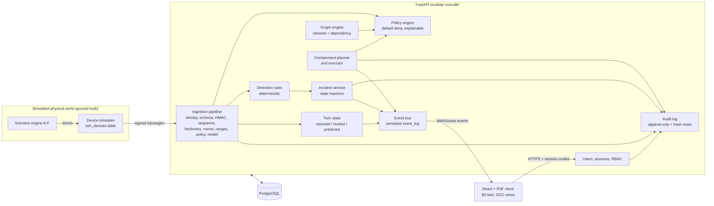
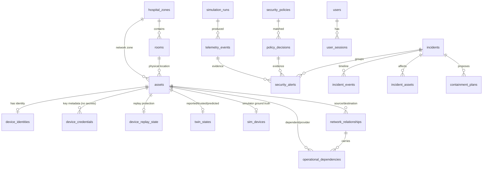
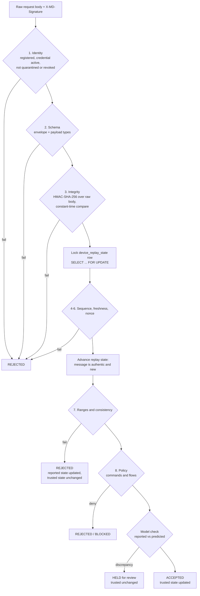

# MedDefender Twin — Architecture

> Everything in this system is simulated: assets, network traffic, telemetry, clinical
> workflows and attacks are synthetic. Nothing here connects to, or controls, real
> clinical infrastructure or medical devices.

## 1. Goals and non-goals

**Goal:** a technically defensible security simulation in which every visual state in the
3D digital twin is the projection of backend-owned, persisted, enforced security state.

**Non-goals:** clinical safety validation, regulatory compliance, production readiness,
real device integration, real exploitation or scanning.

## 2. System overview



### Key architectural rules

1. **The backend is authoritative.** The 3D scene renders backend state; it never invents
   security state. Selecting an asset fetches `/api/v1/assets/{id}`.
2. **The twin only learns through messages.** The simulator's ground truth
   (`sim_devices`) is never read by the twin or the security pipeline. The twin's reported
   and trusted states are built exclusively from messages that crossed the ingestion
   boundary.
3. **One enforcement path.** Live HTTP device messages, the background telemetry generator
   and all attack scenarios go through the same `IngestionPipeline.process()` function.
   Scenarios never write alerts or incidents directly.
4. **Connected is not permitted.** Network relationships do not store an allowed/denied
   flag; status is computed by the policy engine at query time.
5. **Connectivity is not dependency.** `network_relationships` and
   `operational_dependencies` are separate tables with separate semantics. A dependency may
   *reference* the flow that carries it (`carried_by_relationship_id`), which is how
   containment impact is computed, but neither is derived from the other.

## 3. Repository structure

```
meddefender-twin/
├── backend/                 FastAPI modular monolith (Python 3.12)
│   ├── app/
│   │   ├── api/             HTTP + WebSocket routers (thin; no business logic)
│   │   ├── core/            settings, clock, crypto primitives, errors
│   │   ├── db/              engine, session, declarative base
│   │   ├── models/          SQLAlchemy ORM models
│   │   ├── schemas/         Pydantic request/response contracts
│   │   ├── services/        domain logic (pipeline, policy, graph, incidents, audit, ...)
│   │   ├── simulator/       simulated devices, telemetry generator, scenarios A-F
│   │   └── seed/            reproducible baseline dataset
│   ├── alembic/             schema migrations (incl. audit immutability trigger)
│   ├── tests/               pytest: unit, integration, security (real PostgreSQL)
│   ├── scripts/             embedded PostgreSQL helper for machines without Docker
│   └── Dockerfile           API image; entrypoint runs migrations and the seed
├── frontend/                React + TypeScript + Vite + Tailwind + React Three Fiber
│   ├── src/api/             fetch client (CSRF), types, TanStack Query hooks
│   ├── src/state/           live store (Zustand) and the WebSocket connection
│   ├── src/twin/            3D scene: model mapping, overlays, effects, materials
│   ├── src/pages/, features/  console pages, inspector, incident workflow
│   ├── e2e/                 Playwright end-to-end tests
│   └── Dockerfile, nginx/   static build behind nginx, which proxies /api and /ws
├── blender/                 headless Blender build script -> hospital.glb
├── shared/                  hospital_layout.json: single source of layout truth
├── docs/                    architecture, threat model, demo walkthrough, plan
├── docker-compose.yml
└── .github/workflows/       CI: tests, build, Compose smoke and end-to-end tests
```

## 4. Hospital model

### 4.1 Zones and rooms

Assets have **two** location attributes, deliberately distinct:

* `network_zone_id` — the security/network segment the asset is attached to.
* `room_id` — where the asset physically sits in the twin.

Example: `HVAC-SENSOR-01` sits on the ICU wall but is attached to the building-management
network. It is *physically near* the ICU monitors but has *no permitted path* to them.

| Zone | Segment (synthetic) | Purpose |
|---|---|---|
| `ZONE-ICU` | VLAN 110, 10.20.110.0/24 | Bedside monitoring, infusion pump representation, central monitoring gateway |
| `ZONE-IMG` | VLAN 120, 10.20.120.0/24 | Imaging modality and review workstation |
| `ZONE-DC` | VLAN 10, 10.20.10.0/24 | Application, monitoring, identity and imaging-archive servers; core gateway; security tooling |
| `ZONE-BMS` | VLAN 200, 10.20.200.0/24 | Building-management gateway, HVAC controller, environment sensors |

### 4.2 Asset inventory (21 physical + 5 logical)

| Asset ID | Type | Network zone | Physical room | Signs messages |
|---|---|---|---|---|
| ICU-MONITOR-01..03 | Bedside patient monitor | ICU | ICU Bay 1..3 | yes (telemetry) |
| ICU-PUMP-01 | Infusion pump representation | ICU | ICU Bay 1 | yes (telemetry) |
| ICU-GATEWAY-01 | Central monitoring gateway | ICU | ICU Comms Room | yes (telemetry, commands) |
| ICU-SWITCH-01 | Access switch (intra-ICU enforcement point) | ICU | ICU Comms Room | no |
| ICU-WS-01 | Clinical workstation | ICU | Nurse Station | yes (heartbeat) |
| HVAC-SENSOR-01 | Environment sensor | **BMS** | **ICU** Nurse Station | yes (telemetry) |
| IMG-CT-01 | CT scanner representation | IMG | CT Room | yes (telemetry) |
| IMG-WS-01 | Imaging review workstation | IMG | Reading Room | yes (heartbeat, commands) |
| IMG-SWITCH-01 | Access switch (intra-IMG enforcement point) | IMG | Network Closet | no |
| HVAC-SENSOR-02 | Environment sensor | **BMS** | **CT Room** | yes (telemetry) |
| NET-GW-01 | Core zone gateway / firewall (inter-zone enforcement point) | DC | Server Room | no |
| APP-SERVER-01 | Hospital application server | DC | Server Room | no |
| MON-SERVER-01 | Central monitoring server | DC | Server Room | no |
| IAM-SERVER-01 | Identity & access service | DC | Server Room | no |
| IMG-SERVER-01 | Imaging archive server | DC | Server Room | no |
| NET-SENSOR-01 | Network monitoring sensor (flow observations) | DC | Server Room | yes (flow reports) |
| SOC-WS-01 | Security monitoring workstation | DC | Security Office | no |
| BMS-GW-01 | Building-management gateway | BMS | Plant Room | yes (heartbeat, commands) |
| HVAC-CTRL-01 | HVAC controller (AHU-1) | BMS | Plant Room | yes (telemetry) |

Logical services (no physical location): `SVC-CENTRAL-MONITORING`, `SVC-CLINICAL-RECORDS`,
`SVC-IMAGING`, `SVC-ICU-ENVIRONMENT`, `SVC-STAFF-IDENTITY`.

### 4.3 Stable identity and twin mapping

* Asset IDs are backend-owned primary keys and never change.
* Each physical asset has a `twin_node` (Blender object name, e.g. `AST_ICU-MONITOR-01`).
* The Blender build script writes `asset_id` as a custom property, exported as glTF node
  `extras`. The client resolves picks by walking up to the nearest ancestor with
  `extras.asset_id` and verifies on load that every backend asset with a `twin_node` is
  present in the GLB (a mapping diagnostic is shown in the UI).
* A test parses the committed GLB and checks the mapping against the seed.

## 5. Data model



| Table | Purpose |
|---|---|
| `users`, `user_sessions` | Human accounts (argon2id hashes) and server-side sessions (SHA-256 token hashes only) |
| `hospital_zones`, `rooms` | Security zones and physical rooms |
| `assets` | Physical assets and logical services (`asset_kind`, `is_logical`) |
| `device_identities` | Registration status and trust state for message-signing assets |
| `device_credentials` | Key version, algorithm, fingerprint, status. **Never the secret** |
| `device_replay_state` | Last accepted sequence per device, row-locked during ingestion |
| `telemetry_events` | Every received message, accepted or not, with per-check results |
| `twin_states` | Latest reported, trusted and predicted state per asset, kept separately |
| `sim_devices` | Simulator ground truth: device-side counters and physical state |
| `network_relationships` | Modeled communication paths (baseline or observed) and L2 uplinks |
| `operational_dependencies` | What relies on what; may reference the carrying flow |
| `security_policies` | Network-flow and device-command policies (baseline, containment, admin) |
| `policy_decisions` | Every policy evaluation with matched rule and explanation |
| `security_alerts` | Rule hits with evidence, classification, severity and confidence notes |
| `incidents`, `incident_events`, `incident_assets` | Incident workflow and timeline |
| `containment_plans` | Generated plans with impact analysis; applied/rolled-back status |
| `audit_events` | Append-only, hash-chained security audit trail |
| `simulation_runs`, `simulation_state` | Scenario executions, epochs and generator status |
| `event_log` | Persisted real-time events for WebSocket resynchronisation |

Telemetry observations (`telemetry_events`) are stored separately from the latest trusted
state (`twin_states`). Multi-row security decisions (message + replay counter + twin state +
alert + incident + audit) commit in a single transaction.

## 6. Security enforcement flow (device messages)



* Replay state advances only after the HMAC verifies, so unauthenticated traffic cannot
  poison counters or nonces.
* Authentic messages that fail content validation still consume their sequence number,
  so they cannot be re-submitted.
* Failed authentication never penalises the *claimed* identity's trust state; otherwise an
  attacker could lock out a real device by sending garbage under its ID.

## 7. Graph models

**Network graph:** nodes are assets; edges are `network_relationships` of type
`DATA_FLOW`, `CONTROL`, `AUTH`, `MANAGEMENT` (policy-evaluated) or `L2_UPLINK` (topology,
not policy-evaluated and ignored by attack-path analysis).

**Dependency graph:** edges are `operational_dependencies` (`dependent -> provider`) with a
type (`DATA_SOURCE`, `DATA_AGGREGATION`, `APPLICATION_HOSTING`, `AUTHENTICATION`,
`NETWORK_TRANSPORT`, `ENVIRONMENTAL_CONTROL`, `SENSOR_FEEDBACK`, `DISPLAY_ACCESS`,
`CONFIGURATION_MANAGEMENT`) and a criticality.

**Attack-path analysis:** bounded search from an entry asset over flows the policy engine
evaluates as *permitted*, under the current enforcement state. Reachability comes from
policy, not from drawn lines: candidate edges are every modeled relationship (except L2
topology) plus every concrete (source, destination, service) implied by an active allow
policy, with zone selectors expanded to their member assets. Each candidate is then
evaluated by the policy engine, so a higher-priority deny always wins. Every hop is
labelled:

* `DEMONSTRATED`: observed and permitted during the simulation;
* `PERMITTED`: allowed by policy but not observed;
* `HYPOTHETICAL`: requires compromise of an intermediate asset (multi-hop);
* blocked edges are reported as blocked attempts and never traversed.

Physically nearby but unreachable assets are reported separately.

**Containment impact:** a dependency is disrupted when its provider is isolated or the flow
that carries it is blocked. Only HIGH or CRITICAL impairments propagate to the provider's
dependents (at the dependency's own criticality); lower-criticality disruptions are listed
but not cascaded, because the model cannot tell whether the lost function is the one the
dependent relies on. Plans are evaluated as hypothetical policy sets, without writing
anything, and compared on blocked flows, attack-path reduction, residual paths, disrupted
dependencies and affected services.

## 8. Real-time contract

* `GET /ws/events?since=<event_id>` (session-authenticated, Origin checked).
* Every event has a monotonically increasing `id` from the persisted `event_log` table.
* On reconnect, the client sends the last seen id; the server replays missed events from
  `event_log`, or instructs a full resync (`GET /api/v1/twin/state`) if the gap is too old.
* Events are published only **after** the database transaction commits.
* No secrets ever appear in events.

## 9. Digital twin client

The console is a React single-page app; the twin is a React Three Fiber scene inside it.

* **State flow.** `LiveConnection` loads `GET /api/v1/twin/state`, then opens
  `/ws/events?since=<id>`, applies events to a Zustand store and reconnects with backoff,
  falling back to a full resync when told to. Server data that pages need (incidents,
  graphs, policies) comes from TanStack Query and is invalidated by relevant events.
* **Mapping.** The GLB's asset nodes carry `extras.asset_id`. On load the client indexes
  them, compares them with the backend inventory and reports the result in the scene
  ("Twin mapping verified · 21 assets", or the specific mismatches). Picking walks up to
  the nearest node with an asset ID; asset chips are DOM buttons so they are keyboard and
  screen-reader accessible.
* **What is drawn, and from where.** Device tints, room volumes and light pillars come only
  from backend trust and containment state. Network arcs are coloured by the current
  policy decision. Dependency arcs come from the separate dependency graph. Short-lived
  comets come from flow and policy events on the stream, and attack paths and containment
  previews come from the corresponding API results. Motion is reserved for live events;
  potential attack paths are drawn statically so they are not mistaken for traffic.
* **Rendering.** Two view styles (holographic: fresnel hologram shaders, gridded floors,
  bloom; realistic: shadow-mapped key light, image-based lighting from procedural light
  panels, ambient occlusion, floor tiles) and two effect levels. *Reduced* (no
  post-processing, shadow maps or environment lighting) is selected before the 3D view is
  created when a probe shows WebGL running on a software renderer; there the scene also
  renders on demand at about 10 frames per second and at lower resolution, because
  unbounded frames on a CPU rasteriser pile up and starve the page. Overlay lines, comets
  and pillars keep their materials for their whole life and
  update geometry in place, so live updates never force a shader program to be recompiled.
  On a cold shader cache or a CPU renderer such recompiles blocked the page for seconds.
* **Accessibility.** Every status pairs a color with an icon and a text label, charts have
  table views, dialogs for privileged actions require a written justification, and
  `prefers-reduced-motion` disables the camera intro and pulses.

## 10. Deployment (Docker Compose)

```
browser ──http://localhost:8080──▶ nginx (frontend image)
                                    ├─ /           static build (CSP, security headers)
                                    ├─ /api/       ─▶ backend:8000 (FastAPI, uvicorn)
                                    └─ /ws/        ─▶ backend:8000 (WebSocket upgrade)
backend ─▶ db:5432 (PostgreSQL 16, named volume)
```

* One origin for the console, API and WebSocket: the session cookie (SameSite=Strict), the
  CSRF double-submit and the WebSocket Origin check all assume it.
* The backend container runs `alembic upgrade head` and the idempotent seed before starting
  a single uvicorn worker (the event bus is in-process). It is not published to the host,
  so its forwarded headers can only come from nginx.
* Services start in dependency order, gated on healthchecks; the web port is bound to
  127.0.0.1 because the demo accounts have known passwords.

## 11. Known architectural limitations

* The event bus is in-process: horizontal scaling to multiple workers would need
  PostgreSQL `LISTEN/NOTIFY` or a broker.
* Device commands are mediated by the platform's command broker (the policy decision
  point). Real hospitals may have direct device-to-device command paths that would need
  network or device-side enforcement.
* Device keys are derived from a master secret held in the backend environment, standing
  in for a KMS/HSM.
